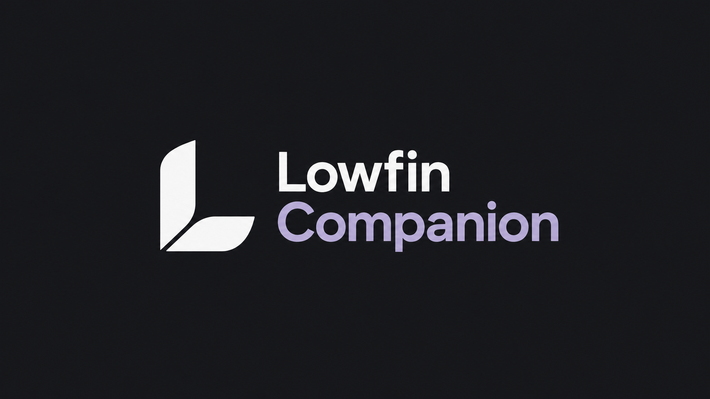

# Lowfin Companion

**Lowfin-eigener Code, Dokumentation und Gestaltung wurden zu 100 % mit KI erstellt. Angepasste Fremdkomponenten sind in den unten verlinkten Hinweisen dokumentiert.**

> **Persönlich getestet:** Ich habe Lowfin und Lowfin Companion selbst ausgiebig getestet. **Offizielle Releases erscheinen erst nach meinen eigenen manuellen Tests.**



Optionales Server-Plugin für **Jellyfin 12.2 oder neuer**, das den [Lowfin-Client für Android TV](https://github.com/303inmyheart/Lowfin) erweitert. Lowfin ist die App zum Durchsuchen und Abspielen deiner Medien am TV; Companion ergänzt zentral verwaltete Funktionen auf dem Server. Lowfin erkennt das Plugin automatisch und funktioniert auch ohne es.

[Aktueller Release](https://github.com/303inmyheart/Lowfin-Companion/releases/latest) · [Changelog](CHANGELOG.md) · [English](README.md)

## Wichtigste Funktionen

- **Smart Completion:** Regeln pro Benutzer und Film/Folge: Jellyfin-Standard, eigener Prozentwert, verbleibende Zeit oder niemals automatisch abschließen. Optionale Regeln für lange Videos; globale Jellyfin-Schwellen bleiben unverändert.
- **Persistent Resume:** Fortsetzposition unabhängig vom Gesehen-Status, mit Schutz vor veralteten Meldungen und Konflikten mit manuellen Aktionen. Regeln gelten für denselben Jellyfin-Benutzer auf seinen Lowfin-Geräten; die Verarbeitung beginnt erst bei aktivierter entsprechender Regel/Fortsetzoption.
- **Inkrementeller Bibliothekscache:** Lowfin lädt geänderte Metadaten/Bilder, statt einen fertigen Cache neu aufzubauen. Das persistente Journal hält bis zu 250.000 Änderungen vor; das ist eine Anzahlgrenze und keine garantierte Tagesanzahl.
- **Zentrale Anbieterzugänge:** OMDb, MDBList, TMDB und Tracearr im Jellyfin-Dashboard einrichten und für alle oder ausgewählte Benutzer freigeben. Jeder TV behält seine Anzeige-/Anbieterauswahl und den optionalen Bewertungscache; Folgenbewertungen bleiben ungecacht.
- **Cover-Tags:** optionale Auflösungs-, HDR-, Codec-, Audio- und Sprachkennzeichnungen im Lowfin-Kartenrahmen. Der persistente Index verarbeitet Bibliotheksereignisse und gleicht sich täglich ab. Originalbilder und Bilder anderer Clients bleiben unverändert.
- **Discord Rich Presence:** optionale Präsenz pro Benutzer mit Bildern sowie Live-TV-Programm und Zeitangaben. Standardmäßig aus; [Einrichtung, Token- und Bild-Upload-Hinweise vor dem Aktivieren lesen (Englisch)](docs/setup-and-development.md#dashboard-navigation-and-discord-presence).

## Installation

1. Unter **Jellyfin-Dashboard → Plugins → Repositories** diese Adresse hinzufügen:

   ```text
   https://raw.githubusercontent.com/303inmyheart/Lowfin-Companion/main/manifest.json
   ```

2. **Lowfin Companion** aus dem Plugin-Katalog installieren und Jellyfin neu starten.
3. Im Companion-Dashboard die gewünschten Funktionen und Benutzerfreigaben einstellen, anschließend Lowfin erneut öffnen.

Derselbe Repository-Link liefert kompatible Plugin-Updates; nach einem Update Jellyfin neu starten. Manuelle Pakete stehen ebenfalls unter [Releases](https://github.com/303inmyheart/Lowfin-Companion/releases). Künftige Jellyfin-Versionen können Plugin-Schnittstellen ändern; eine unbegrenzte Kompatibilitätsgarantie gibt es daher nicht.

## Wofür ist Lowfin?

**[Lowfin](https://github.com/303inmyheart/Lowfin)** ist die separate TV-App: fernbedienbare Film-/Serienbibliotheken, Live TV, anpassbare Startseitenreihen, nativer Player und persistenter lokaler Bibliothekscache. Lowfin wird auf dem TV installiert; Companion kommt bei Bedarf zusätzlich auf den Jellyfin-Server.

## Anleitungen und Quellen

- [Einrichtung, manuelle Installation, Backups und selbst bauen (Englisch)](docs/setup-and-development.md)
- Inspirationen: Discord RPC durch die Scripts aus [kennethsible/jellyfin-rpc](https://github.com/kennethsible/jellyfin-rpc), Auflösungs-/Audiobanner durch [JellyTag](https://github.com/Atilil/jellyfin-plugins/tree/main/Jellytag) und Bewertungen durch [TMDb Helper](https://github.com/jurialmunkey/plugin.video.themoviedb.helper).
- [Fremdkomponenten und Herkunft](THIRD_PARTY.md) · [GNU GPL v2](LICENSE)
