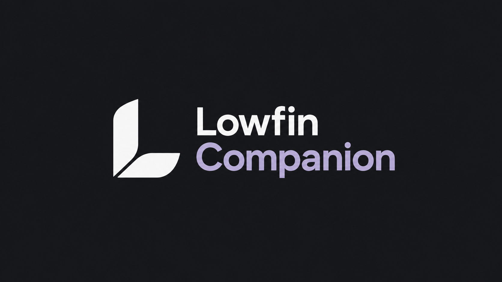

# Lowfin Companion

**100% AI-generated — this project's code, documentation and design were created with AI.**



Optional server-side companion for [Lowfin](https://github.com/303inmyheart/Lowfin), designed for **Jellyfin 12.2.x**. Current plugin version: **0.5.1**. The Android TV client works independently when the plugin is absent.

[Deutsche Anleitung](README.de.md)

[Changelog](CHANGELOG.md) · [Releases](https://github.com/303inmyheart/Lowfin-Companion/releases)

## Features

- **Smart Completion:** per-user, per-movie/episode rules: Jellyfin default, custom percentage, remaining time or never auto-complete. Existing Jellyfin global thresholds stay unchanged. Only an explicitly selected rule or enabled long-video rule activates Companion processing.
- **Persistent Resume:** independent resume positions, playback sequence/order checks, and fences for manual watched/reset actions. The same Jellyfin user's selected rules apply across Lowfin devices.
- **Incremental library cache:** a persistent change journal lets Lowfin update changed metadata and artwork instead of rebuilding the completed library cache. Library permissions and resume exclusions remain respected.
- **Server-side provider configuration:** OMDb, MDBList, TMDB and Tracearr credentials in the Jellyfin plugin dashboard, with all-user or selected-user access. Lowfin retains its provider/display toggles and local rating-cache setting.
- **Cover tags:** optional DVD/SD, 5.1 and HDR facts. Lowfin draws the labels in the visible artwork frame; originals and other clients' images stay unchanged. Series/season DVD majority uses available episodes. HDR tags additionally require HDR playback enabled in that Lowfin client.
- **Persistent tag index:** event-driven changes plus a 24-hour reconciliation task. Version 0.5.1 adds progress, phase counters and 15-second diagnostic logs; search the Jellyfin log for `Lowfin cover index`.

## Compatibility and limits

Requires **Jellyfin 12.2.x** and .NET 10 for development. Builds outside that server line need a compatibility check; detection deliberately does not advertise support for another Jellyfin minor version. Normal Jellyfin authentication and playback reporting remain in use. Other Jellyfin clients and tracking systems retain their existing completion rules. Lost historical positions cannot be reconstructed.

Movie/series external ratings follow Lowfin's existing cache settings. Episode-specific ratings are requested on demand and are not cached. This plugin does not change your video files or global Jellyfin completion settings.

## Install a locally built package

Download the locally built package from [GitHub releases](https://github.com/303inmyheart/Lowfin-Companion/releases). This repository has no GitHub Actions workflow; releases are built and uploaded locally.

1. Download the `-manual.zip` release asset, or build and package locally (see below). The unsuffixed ZIP is the flat package used by Jellyfin’s repository installer.
2. Stop Jellyfin.
3. Extract `artifacts/Lowfin-Companion-0.5.1.zip` and copy its entire `Lowfin.Companion_0.5.1.0` directory into Jellyfin's plugin directory. DLL, `meta.json` and image must be directly inside that versioned directory.
4. Move the previous Companion plugin directory out of `plugins` as a backup, so only one version loads. Preserve the separate `lowfin-companion` data directory.
5. Start Jellyfin and open Dashboard → Plugins → Lowfin Companion. Configure providers/user access and optional tags there, then reopen Lowfin.

The plugin directory is often `/var/lib/jellyfin/plugins` on Linux or `/config/plugins` in Docker; use your server's actual configured path. Server configuration/data and API keys do **not** belong in this Git repository.

## Build and test locally

Prerequisites: **.NET SDK 10**, Python 3.10+, and network access to NuGet for the first restore. No Android SDK or GitHub Actions minutes are needed.

```bash
dotnet test tests/Lowfin.Companion.Tests/Lowfin.Companion.Tests.csproj -c Release
dotnet build src/Lowfin.Companion/Lowfin.Companion.csproj -c Release
python3 tools/package.py
```

Or run `bash tools/build.sh`. Set `DOTNET=/absolute/path/to/dotnet` if the SDK is not on PATH. Packaging writes the manual-install ZIP, versioned plugin folder, `meta.json`, artwork and checksums under ignored `artifacts/`. The test suite covers long videos, persistent resume, races, explicit user actions, permissions, provider behavior, tag detection/indexing and index progress.

## Install and update through Jellyfin

Add this repository URL under **Jellyfin Dashboard → Plugins → Repositories**:

```text
https://raw.githubusercontent.com/303inmyheart/Lowfin-Companion/main/manifest.json
```

Then open the plugin catalog, select Lowfin Companion and install it. Jellyfin's plugin-update task can check the same feed for future compatible releases. Restart Jellyfin after installation or an update. If an older manually installed package has `autoUpdate: false` in its `meta.json`, automatic checks remain disabled for that installation. With Jellyfin stopped, change that flag to `true` (preserving all other metadata) or replace it with the current manual package before relying on scheduled updates. The manifest uses the stable Companion GUID and Jellyfin 12.2 ABI. The ordinary GitHub project page is not a Jellyfin repository URL.

The local tool prepares a standard feed for a future approved HTTP(S) hosting directory, without uploading anything:

```bash
python3 -m unittest discover -s tools -p 'test_*.py'
python3 tools/make_repository.py \
  --base-url https://YOUR-HOST/lowfin-companion/ \
  --output artifacts/feed
```

The example command illustrates custom hosting. For the published feed, sourceUrl points to the corresponding public GitHub release asset. The output contains:

- `manifest.json` with stable plugin GUID, version, Jellyfin ABI, package URL and Jellyfin-required MD5 checksum;
- a **flat** install ZIP with the DLL at its root, matching Jellyfin's installer;
- plugin image and an additional SHA-256 checksum.

The normal manual-install ZIP uses a versioned outer directory; the feed ZIP deliberately does not. Run the generator in the same output directory to retain previous manifest versions and their packages. For a future update, build locally, regenerate the feed, upload its files to the approved host, then let Jellyfin's configured plugin-update task check it. New plugin versions need a Jellyfin restart to load. For this repository, the approved host is GitHub: commit the generated manifest/image and upload the matching ZIP to its release. Keep the sourceUrl and checksum matched to the exact uploaded bytes.

## Data and diagnostics

Persistent plugin data lives below `<Jellyfin data directory>/lowfin-companion/`, including per-user completion/resume files, the change journal and `badge-index.json`. Include this directory and the Jellyfin plugin configuration in server backups. Uninstalling the plugin does not automatically erase these files.

Index status is available in the admin-only plugin dashboard/status endpoint. Existing snapshots stay usable during rebuilding, cancellation or failures. Provider secrets are admin-configured and are not returned to ordinary Lowfin users.

## Source layout

- `src/Lowfin.Companion/`: native Jellyfin plugin, API, state, providers, journal and index.
- `tests/Lowfin.Companion.Tests/`: .NET regression tests.
- `tools/`: local build, manual packaging and optional feed preparation.
- `assets/`: plugin artwork and design notes.

Licensed under [GNU GPL v2](LICENSE), matching the Lowfin project.
