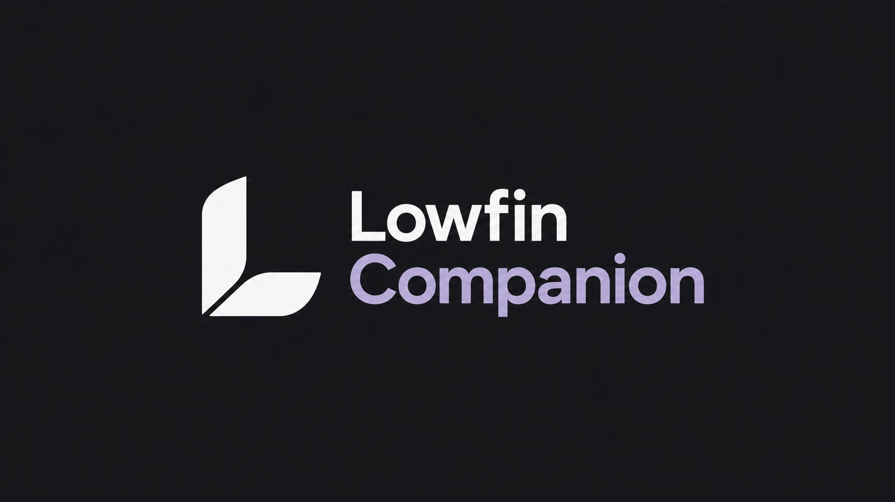

# Lowfin Companion

**Lowfin-specific code, documentation and design are 100% AI-generated. Adapted third-party components are identified in the notices below.**

> **Personally tested:** As the project owner, I have extensively tested both Lowfin and Lowfin Companion myself. **Official releases are published only after my own manual testing.**



An optional server plugin for **Jellyfin 12.2 or newer**, extending the [Lowfin Android TV client](https://github.com/303inmyheart/Lowfin). Lowfin is the app used to browse and play your media on the TV; Companion adds server-managed features. The client detects it automatically and continues to work when it is not installed.

[Latest release](https://github.com/303inmyheart/Lowfin-Companion/releases/latest) · [Changelog](CHANGELOG.md) · [Deutsch](README.de.md)

## Main features

- **Smart Completion:** per-user rules for individual movies/episodes: Jellyfin default, custom percentage, remaining time or never auto-complete. Optional rules for long videos; global Jellyfin thresholds remain unchanged.
- **Persistent Resume:** retain playback positions independently of watched status, with protections against stale events and manual-action races. Rules follow the same Jellyfin user across Lowfin devices; processing starts only when the corresponding rule/resume option is enabled.
- **Incremental library cache:** a persistent journal lets Lowfin fetch changed metadata/artwork instead of rebuilding a completed cache. It retains up to 250,000 changes; retention is count-based, not a guaranteed number of days.
- **Central provider access:** configure OMDb, MDBList, TMDB and Tracearr in the Jellyfin dashboard and share access with all or selected users. Each TV keeps its own display/provider choices and optional local rating cache; episode ratings remain uncached.
- **Cover tags:** optional resolution, HDR, codec, audio and language labels in Lowfin's card frames. A persistent index follows library events and reconciles daily; original artwork and other clients' images are unchanged.
- **Discord Rich Presence:** optional per-user presence, artwork and Live TV programme information/timing. Disabled by default; [read the setup, token and artwork-upload notes before enabling it](docs/setup-and-development.md#dashboard-navigation-and-discord-presence).

## Install

1. In **Jellyfin Dashboard → Plugins → Repositories**, add:

   ```text
   https://raw.githubusercontent.com/303inmyheart/Lowfin-Companion/main/manifest.json
   ```

2. Install **Lowfin Companion** from the plugin catalog and restart Jellyfin.
3. Open the Companion dashboard to configure the features and user access you need, then reopen Lowfin.

The same repository feed provides compatible plugin updates; restart Jellyfin after an update. Manual packages are also available under [Releases](https://github.com/303inmyheart/Lowfin-Companion/releases). Future Jellyfin versions can change plugin APIs, so compatibility with every future server release is not guaranteed.

## About Lowfin

**[Lowfin](https://github.com/303inmyheart/Lowfin)** is the separate Android TV app: remote-friendly movie/series browsing, Live TV, customizable home rows, native playback and a persistent local library cache. Install it on your TV; install Companion on the Jellyfin server only if you want these additional features.

## Documentation and credits

- [Configuration, manual installation, backups and building from source](docs/setup-and-development.md)
- Feature inspirations: Discord RPC from the scripts in [kennethsible/jellyfin-rpc](https://github.com/kennethsible/jellyfin-rpc), resolution/audio banners from [JellyTag](https://github.com/Atilil/jellyfin-plugins/tree/main/Jellytag), and ratings from [TMDb Helper](https://github.com/jurialmunkey/plugin.video.themoviedb.helper).
- [Third-party notices and source provenance](THIRD_PARTY.md) · [GNU GPL v2 license](LICENSE)
